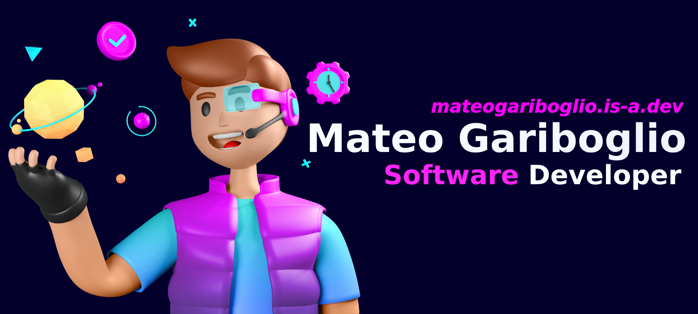

  
  
  

    <b>University Technician in Programming (UTN)</b> | Computer Engineering Student (UNL)
  

  

    
    
    
  

---

### 👨🏻‍💻 About Me

I’m not just about writing code; I focus on solving business problems. I have a solid foundation in **Object-Oriented Programming** and **Layered Architecture**.  
I work across the stack: **Go** and the **Java ecosystem (Spring Boot, JPA)** on the backend, **React + TypeScript** on the frontend, and **PostgreSQL** underneath.

* 🔭 **Currently working on:** Multi-tenant SaaS for small businesses and AI integrations (MCP servers), at [Matecito Tech](https://github.com/matecito-tech).
* 🎓 **Education:** Ongoing education at UTN and UNL.
* 🤝 **Soft Skills:** Direct communication, critical thinking, and efficient use of resources.
* 🌍 **Availability:** Remote, Hybrid, or On-site (Open to relocation).

---

### 🛠 Tech Stack

**Core & Backend**

**Frontend & Tools**

